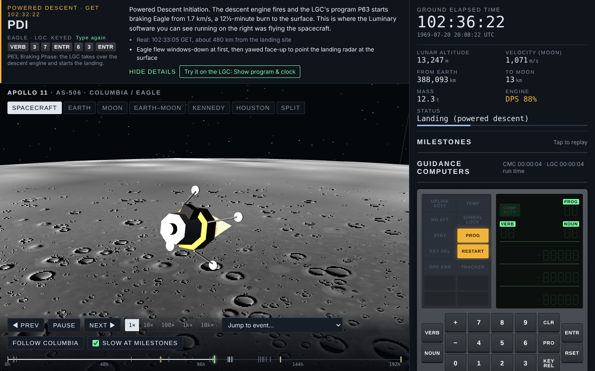

# Apollo 11 simulator

**[▶ Open the simulator](https://mastaba.github.io/apollo11-sim/)**

A browser recreation of Apollo 11, from liftoff to splashdown. The trajectory is flown in full 3D with real
orbital mechanics. Alongside it, the actual Apollo Guidance Computer software (Comanche 055 for Columbia and
Luminary 099 for Eagle) runs on an emulated AGC behind two working DSKYs.



## What's in it

- **The flight, computed in your browser.** It launches from Pad 39A at the real time (13:32 UTC, 16 July 1969)
  and uses the Moon's and Sun's 1969 positions, Earth's rotation and oblateness, and the IAU lunar orientation.
  Closed-loop guidance flies every engine burn: TLI, LOI, DOI, the P63/P64/P66 landing, ascent, rendezvous,
  TEI and entry.
- **The real flight software.** Comanche 055 and Luminary 099 run on Virtual AGC's yaAGC engine, compiled to
  WebAssembly. The cores are byte-identical to the flown ropes. At each milestone the crew's keystrokes
  (for example V37E63E at PDI, or V05N09E for the 1202 alarm) are typed into the DSKY, and the real program
  responds. You can type on the DSKYs yourself too.
- **About 50 milestones**, each with an explanation. Playback slows to real time as each one arrives.
- **Animated events:** transposition and docking, extraction, the slews before and after each burn,
  undocking, landing, the moonwalk (from the Apollo Lunar Surface Journal timeline, including Armstrong's walk
  to Little West crater), ascent, docking, CM/SM separation, entry and parachutes.
- **Ground views** of Launch Complex 39 at Kennedy Space Center and of Mission Control at the Manned
  Spacecraft Center in Houston, both as they stood in 1969, plus map labels on the globe.

## Run it

Open [`index.html`](index.html) in any modern browser. It is one self-contained file; three.js loads from
cdnjs, and everything else is embedded.

## Build

`index.html` is generated. Edit the files under `sim/`, then run:

```sh
python3 sim/build.py
```

| Path | Contents |
|---|---|
| `sim/app.src.html` | Page template: layout, styles, DSKY, licence section |
| `sim/mission.js` | Ephemerides, gravity model, integrator |
| `sim/builder.js` | Mission targeting and guidance; builds every track at page load |
| `sim/app.js` | Rendering, camera, milestones, DSKY wiring |
| `sim/edu.js` | Milestone text and the keystrokes typed at each milestone |
| `sim/eva.js` | Moonwalk timeline |
| `agc/` | yaAGC engine source, browser shim, `build.sh`, and the prebuilt `agc.wasm` |
| `ropes/` | Comanche 055 and Luminary 099 core images, and how they were assembled |
| `assets/textures/` | Earth and Moon textures |

To rebuild `agc/agc.wasm`, install [wasi-sdk](https://github.com/WebAssembly/wasi-sdk) 25 and run
`sh build.sh` in `agc/`. The output is byte-for-byte identical to the committed binary.

## Simplifications

- The guidance computers aren't connected to the simulated spacecraft's sensors; they run alongside the flight.
  Programs such as P63 light the PROG lamp, because no IMU or navigation data is wired in.
- The rendezvous burns are replaced by a smooth guided blend.
- Midcourse corrections are not flown, and lunar gravity has no mascons.
- Entry uses a fixed bank profile, so splashdown lands a few hundred km from the real point.
- The buildings at Kennedy and Houston are simplified models in approximate positions.

## Licence

This project is free software, released under the **GNU General Public License v2 or later** (see
[`LICENSE`](LICENSE)). It has no warranty.

| Component | Licence |
|---|---|
| yaAGC emulator from [Virtual AGC](https://github.com/virtualagc/virtualagc), © 2003–2019 Ronald S. Burkey and contributors | GPL v2 or later |
| Simulator code (`sim/`, `agc/shim.c`, `agc/agc.js`) | GPL v2 or later |
| Apollo flight software, Comanche 055 and Luminary 099 (MIT Instrumentation Laboratory for NASA) | Public domain |
| [three.js](https://threejs.org) r128, loaded from cdnjs | MIT ([`licenses/three.js-MIT.txt`](licenses/three.js-MIT.txt)) |
| Earth and Moon textures, from the three.js examples, derived from NASA imagery | MIT / public domain |
| IBM Plex and Saira Condensed fonts, served by Google Fonts | SIL OFL 1.1 |

The page offers the emulator's complete corresponding source for download from its "Licences & source code"
section. `sim/build.py` regenerates that bundle from `agc/` on every build, so it always matches the binary.
